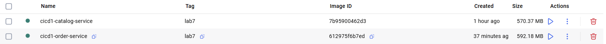

OrderService

Port: 8082

Catalog Repo: https://github.com/deira-v/cicd1-catalog-service

Endpoints: localhost:8082/swagger-ui/index.html 

* productId refers to a product owned by Catalog, no network call exists yet.

## **Lab 7**  
* Maven package must run before docker build because Docker expects the .jar image file when it runs.
* A Docker Image is a packaged, read-only template containing everything your application needs to run.  
  A Container is an instance of a Docker image that has been started. It provides an isolated environment in which your application executes.
* 8082:8082 is a Docker port mapping. It connects a port on your Windows machine (host) to a port inside the Docker container.
  EXPOSE 8082 does not make it accessible from Windows.

